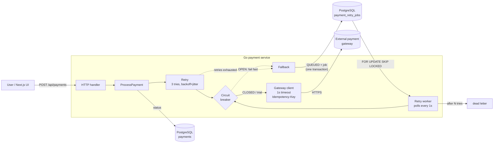

# 69 — Circuit Breaker for a Payment Gateway (Go + PostgreSQL + Next.js)

> **Interview scenario:** "Your microservice e-commerce platform calls an external
> payment gateway. Sometimes the gateway is down and payments fail. How do you keep
> the system resilient while giving users the best experience?"

This folder is a **working demo** of the standard answer:

1. **Circuit breaker**: stop calling a gateway that is clearly down, and fail fast.
2. **Retry with exponential backoff + jitter**: ride out short blips.
3. **Fallback**: save the payment and say "order placed, payment processing" instead of showing an error.
4. **Async retry via a durable queue**: a worker finishes the payment when the gateway recovers, with a **dead-letter** state if it never does.
5. **Idempotency keys**: retries can **never** charge a card twice.

| Doc | Use it for |
|---|---|
| [docs/01-concepts.md](docs/01-concepts.md) | The theory, with diagrams. Read this first. |
| [docs/02-code-walkthrough.md](docs/02-code-walkthrough.md) | Each scenario as a sequence diagram, mapped to the Go code |
| [docs/03-interview-qa.md](docs/03-interview-qa.md) | A 60-second answer, 25 likely questions and the traps |

---

## The whole thing on one page



What the user sees:

| Gateway state | Response | User message |
|---|---|---|
| healthy | `201 Created` | "Payment successful" |
| blip (fails, then works on retry) | `201 Created`, a bit slower | "Payment successful" |
| down / breaker open | `202 Accepted` in ~5 ms | "Order placed: payment is processing, we'll notify you" |
| card declined | `402 Payment Required` | "Card declined, try another card" |
| same order sent twice | `200 OK` | The original result (no second charge) |

---

## Run it

You need Go 1.26+ and Node 18+. You don't need Docker: `cmd/devpg` downloads and runs a throw-away PostgreSQL.

Terminal 1, the database (port 5433, so it won't clash with a local Postgres on 5432):

```powershell
go run ./cmd/devpg
```

Terminal 2, the Go API (port 8080) plus the fake gateway (port 8090) plus the retry worker:

```powershell
go run ./cmd/api
```

Terminal 3, the dashboard at http://localhost:3000:

```powershell
cd web; npm install; npm run dev
```

Using your own Postgres instead? Set `DATABASE_URL` (see [.env.example](.env.example)).
If you prefer Docker for the database, run `docker compose up -d` (it also uses port 5433).

Unit tests (circuit breaker state machine and retry/backoff):

```powershell
go test ./...
```

---

## Things to try (all from the dashboard)

| # | Do this | What you should see | Concept |
|---|---|---|---|
| 1 | Healthy → Pay | `SUCCEEDED`, 1 attempt | baseline |
| 2 | Flaky 50% → Pay ×5 | `retry attempt 1 failed … retrying in 140ms`, mostly success | retry + backoff + jitter |
| 3 | Down → Burst ×20 | breaker goes **CLOSED → OPEN**, then the rest are `QUEUED` in ~5 ms | circuit breaker, fail fast, fallback |
| 4 | Healthy, wait 10s | **OPEN → HALF_OPEN → CLOSED**, the queue empties | half-open probing, async retry |
| 5 | Slow → Pay, then Healthy | sync call times out, later `idempotent replay`, "double charges blocked" goes up | idempotency |
| 6 | Down → Pay, wait ~1 min | job becomes `dead`, payment `FAILED` | dead-letter queue |
| 7 | Down → "check" on a row | "Served from cache (fallback)" | cached fallback on reads |
| 8 | Pay 900 | `402`, the breaker is **not** affected | business vs technical errors |

---

## Folder map

```
cmd/api/            wiring: config, breaker settings, starts API + fake gateway + worker
cmd/devpg/          embedded PostgreSQL for local runs
internal/breaker/   circuit breaker (hand-written, Resilience4j-style) + tests
internal/retry/     retry with exponential backoff + full jitter + tests
internal/gateway/   FAKE external gateway (server.go) and our client (client.go)
internal/payment/   ProcessPayment (sync path + fallback), Worker (async path), event log
internal/store/     PostgreSQL: payments, retry jobs, SKIP LOCKED claim, dead letter
internal/httpapi/   JSON endpoints used by the UI
migrations/         schema (embedded into the binary)
web/                Next.js dashboard (polls /api/state every second)
```

### API

| Method | Path | Purpose |
|---|---|---|
| POST | `/api/payments` `{orderId?, amount}` | Pay (201 / 202 / 402 / 200 duplicate) |
| GET | `/api/payments` | Recent payments with retry-job info |
| GET | `/api/payments/{orderId}` | Live status from the gateway, or cached DB status if the gateway is down |
| GET | `/api/state` | Breaker snapshot, counts, gateway stats, timeline |
| PUT | `/api/gateway` `{mode, failureRate}` | Switch the fake gateway: healthy / flaky / slow / down |
| POST | `/api/demo/burst` `{count, amount}` | Fire N payments concurrently |
| POST | `/api/demo/reset` | Truncate demo tables |

---

## Demo values vs production values

The numbers are small so every transition is visible in seconds.

| Setting | Demo | Typical production |
|---|---|---|
| Sliding window | last 10 calls | 50–100 calls, or a 60s time window |
| Minimum calls before judging | 5 | 20+ |
| Failure-rate threshold | 50% | 50% |
| Wait in OPEN | 10s | 30–60s |
| Trial calls in HALF_OPEN | 3 | 5–10 |
| Sync retries | 3 attempts, 200ms→1s | 2–3 attempts, keep the total under the user's patience (~3s) |
| Async retries | 6 attempts, 2s→30s | 10+ attempts over hours, then DLQ + alert |
| HTTP timeout to gateway | 1s | p99 latency × 2–3 (often 3–10s for payments) |
