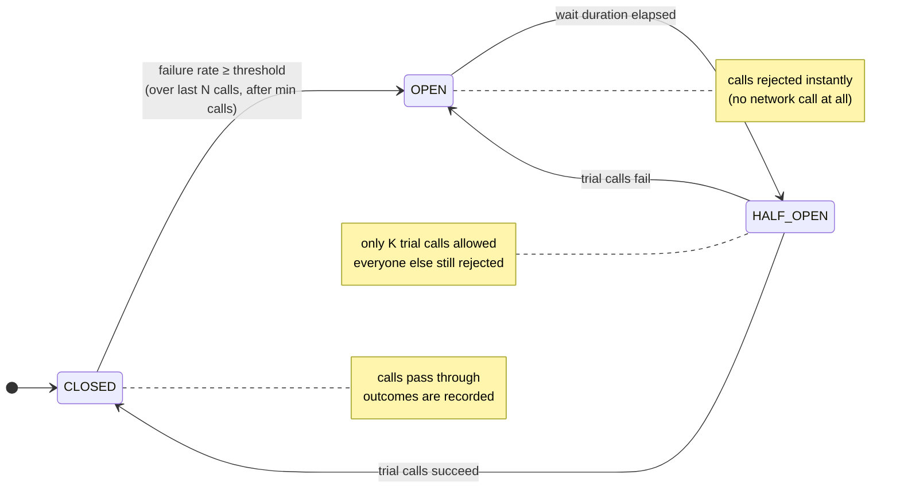
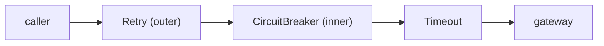
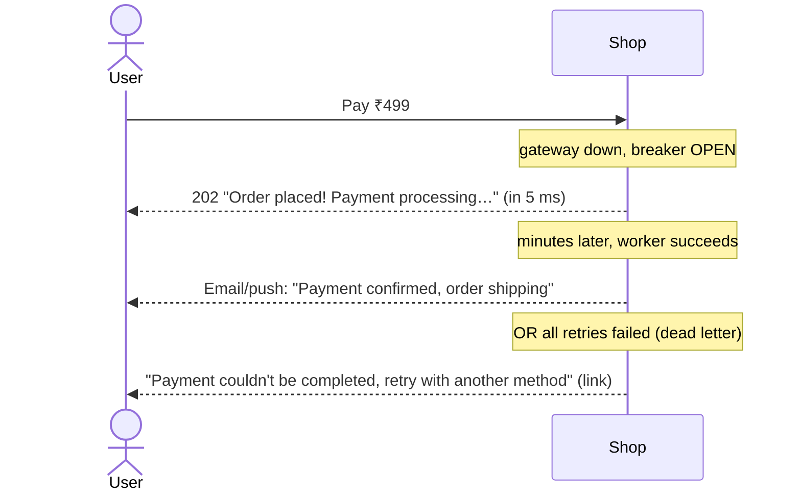
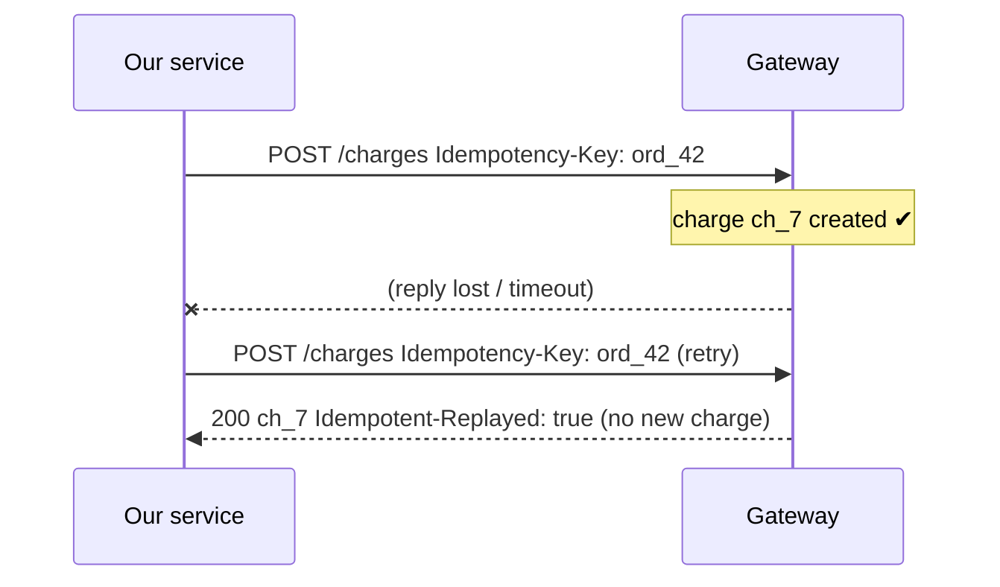
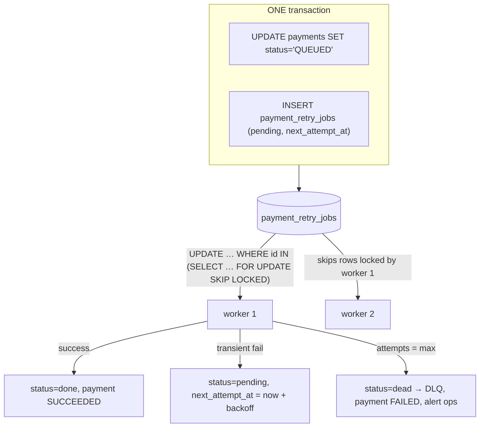

# 01 — Concepts: Circuit Breaker, Retry, Fallback, Async Retry

Read top to bottom once. Each section ends with a **"say it in an interview"** line.

---

## 1. The problem in one picture

Without protection, a dead gateway takes **your** service down with it:

```
 users ──► your API ──► payment gateway (DOWN, each call hangs 30s)
             │
             ├─ every request holds a goroutine/thread + a DB connection for 30s
             ├─ the thread/connection pool fills up
             ├─ now even /products and /cart are slow (they share the pool)
             └─ users click "Pay" again → even more load → CASCADING FAILURE
```

Three things go wrong:

| Problem | Fix |
|---|---|
| We wait too long on a dead dependency | **Timeouts** (always) |
| We keep calling something we *know* is down | **Circuit breaker** |
| Short blips fail payments that would have worked a second later | **Retry with backoff** |
| The user gets an error page and the sale is lost | **Fallback**: accept the order, finish the payment later |
| "Later" must survive crashes and restarts | **Durable queue** + worker |
| Retrying a payment might charge twice | **Idempotency key** |

> **Say it:** "A slow or dead dependency is worse than a fast failure, because it eats
> your resources. So I bound every call with a timeout, stop calling a dependency that's
> clearly down with a circuit breaker, and turn the failure into a degraded but
> successful user experience."

---

## 2. Circuit breaker: the electrical analogy

A house fuse trips when too much current flows. That protects the wiring. You don't keep
plugging things in; you wait, then try again.

In software, the breaker sits **in front of** the remote call and watches the results.



| State | Calls go to gateway? | What it does | Analogy |
|---|---|---|---|
| **CLOSED** | Yes | Records success/failure in a sliding window | Fuse is fine |
| **OPEN** | **No**, returns `ErrOpen` in microseconds | Waits `waitDurationInOpenState` | Fuse tripped |
| **HALF_OPEN** | Only `permittedCallsInHalfOpen` trial calls | The trial results decide CLOSED or OPEN | Carefully flip the switch back |

### Why "fail fast" helps everyone

1. **Your service**: no goroutines/threads stuck waiting, so other features keep working.
2. **The gateway**: it gets breathing room to recover instead of a flood of retries.
3. **The user**: an instant "we'll process it shortly" beats a 30-second spinner and then an error.

### The sliding window (count-based)

The breaker keeps the outcomes of the **last N calls** in a ring buffer.
Demo settings: N = 10, minimum = 5, threshold = 50%.

```
calls:   ✔ ✔ ✘ ✔ ✘ ✘            → 3 failed / 6 = 50%  → TRIP to OPEN
          ▲
          oldest; drops out when the 11th call arrives

calls:   ✘ ✘ ✘                  → 3/3 = 100%, but only 3 calls < minimum 5 → stay CLOSED
                                  (stops one unlucky call from tripping on a quiet system)
```

There is also a **time-based** window ("calls in the last 60s"). That is better when
traffic varies a lot. Resilience4j supports both: `slidingWindowType: COUNT_BASED | TIME_BASED`.

### Slow calls count too

A gateway that answers in 8s is "up" but useless. The breaker can also trip when
`slowCallRate ≥ slowCallRateThreshold`, where "slow" means longer than `slowCallDurationThreshold`.

### Which errors count as failures? (very common follow-up)

| Error | Counts against breaker? | Retry? | Why |
|---|---|---|---|
| 503, 502, 504, 429, timeout, connection refused | **Yes** | **Yes** | The gateway is sick or overloaded |
| 402 card declined / insufficient funds | **No** | **No** | The gateway is healthy; it answered correctly |
| 400 / 422 bad request | **No** | **No** | Our bug; retrying won't help |
| `ErrOpen` (breaker rejected) | n/a | **No** | Retrying an open breaker just wastes time |

In this repo, `IsBreakerFailure` and `IsRetryable` are in [internal/payment/service.go](../internal/payment/service.go).

> **Say it:** "If declines counted as failures, a promo weekend with lots of declined
> cards would trip the breaker and block *every* payment. Only infrastructure errors
> should count."

### Resilience4j config ↔ this repo

```yaml
# application.yml (Spring Boot + Resilience4j)
resilience4j.circuitbreaker.instances.paymentGateway:
  slidingWindowType: COUNT_BASED
  slidingWindowSize: 10
  minimumNumberOfCalls: 5
  failureRateThreshold: 50
  slowCallDurationThreshold: 800ms
  slowCallRateThreshold: 80
  waitDurationInOpenState: 10s
  permittedNumberOfCallsInHalfOpenState: 3
  automaticTransitionFromOpenToHalfOpenEnabled: false   # lazy, like ours
  ignoreExceptions: [com.shop.CardDeclinedException]    # = our IsBreakerFailure
```

| Resilience4j | Go (`breaker.Config`) |
|---|---|
| `slidingWindowSize` | `SlidingWindowSize` |
| `minimumNumberOfCalls` | `MinimumNumberOfCalls` |
| `failureRateThreshold` | `FailureRateThreshold` |
| `slowCallDurationThreshold` / `slowCallRateThreshold` | same names |
| `waitDurationInOpenState` | `WaitDurationInOpenState` |
| `permittedNumberOfCallsInHalfOpenState` | `PermittedCallsInHalfOpen` |
| `recordExceptions` / `ignoreExceptions` | `IsFailure func(error) bool` |
| `CallNotPermittedException` | `breaker.ErrOpen` |
| `circuitBreaker.executeSupplier(...)` | `breaker.Call(cb, func() (T, error) {...})` |
| event publisher `onStateTransition` | `OnStateChange` |

### Hystrix vs Resilience4j vs others

| | Hystrix (Netflix) | Resilience4j | Go | Node (you know this) |
|---|---|---|---|---|
| Status | **Maintenance mode since 2018** | Active, the default choice in Spring | `sony/gobreaker`, `failsafe-go` | `opossum` |
| Isolation | Thread pool per dependency (heavy) | Semaphore / bulkhead, functional decorators | Goroutines + context | Promises |
| Style | Subclass `HystrixCommand` | Compose decorators: `Retry(CB(fn))` | Wrap a func | Wrap an async fn |

> **Say it:** "Hystrix is deprecated. I'd use Resilience4j in Java, gobreaker or a small
> hand-rolled breaker in Go, and opossum in Node. The concepts are identical."

---

## 3. Retry with exponential backoff + jitter

Retry fixes **transient** faults: one dropped packet, one pod restarting, a 2-second GC pause.

### Exponential backoff

Wait longer after each failure so a struggling server isn't hammered:

```
wait(n) = min(maxBackoff, initial × multiplier^(n-1))

initial=200ms, ×2, max=1s:
 attempt 1 fails → wait 200ms
 attempt 2 fails → wait 400ms
 attempt 3 fails → wait 800ms
 attempt 4 fails → wait 1000ms (capped)
```

### Jitter: why randomness matters

Suppose 1,000 clients fail at 12:00:00.000. With plain backoff they **all** retry at
12:00:00.200, then all at 12:00:00.600, and so on. These synchronized waves are the
*thundering herd*. They can knock the gateway over again just as it recovers.

```
No jitter:                          Full jitter (wait = random(0, cap)):
 load                                load
  █         █         █              ▃▅▄▆▅▄▃▅▄▆▄▃▅▄▃▄▅▃▄▄▃▅▄▃
  █         █         █              smooth, spread out
──┴─────────┴─────────┴── time      ─────────────────────── time
```

This repo uses **full jitter** (`random[0, cap)`), the approach AWS recommends.
See [internal/retry/retry.go](../internal/retry/retry.go).

### Rules for safe retries

1. **Only retry idempotent operations**, or make them idempotent (section 6).
2. **Only retry transient errors** (5xx, timeouts). Never 4xx or declines.
3. **Cap the attempts and the total time.** The user is waiting: 3 sync attempts ≈ 2s max.
4. **Don't retry at every layer.** If the gateway SDK retries 3× and your service retries 3×
   and the API gateway retries 3×, one click becomes **27 calls**. Retry in one place.
5. **Respect `Retry-After`** headers on 429/503 when present.

> **Say it:** "Retries without backoff and jitter turn a small outage into a DDoS on
> your own dependency."

---

## 4. Combining retry and circuit breaker: order matters



This is Resilience4j's default decorator order: `Retry ( CircuitBreaker ( RateLimiter ( TimeLimiter ( Bulkhead ( fn ) ) ) ) )`.

| Order | Behaviour |
|---|---|
| **Retry(CB(fn))** ✅ | Each attempt is recorded by the breaker. When the breaker opens mid-retry, the next attempt gets `ErrOpen`, which is **not retryable**, so we stop and use the fallback at once. |
| CB(Retry(fn)) | The breaker sees 1 "call" per 3 attempts and learns too slowly. It also hides how bad things are. |

You can see this in the demo timeline: `retry attempt 2 failed …` →
`breaker CLOSED → OPEN` → `fallback: queued (circuit open — gateway call skipped)`.

---

## 5. Fallbacks: what to do when the call can't happen

| Fallback type | Example | Good for payments? |
|---|---|---|
| **Queue for later** (this demo) | "Order placed, payment processing" + async retry | ✅ **Best for writes** |
| Cached / last-known value | Show the last known payment status, marked stale | ✅ For **reads** (`GET /api/payments/{id}`) |
| Alternate provider | Fail over from Stripe to Adyen | ✅ If you have a second contract (costs money and complexity) |
| Default value | "Recommendations unavailable" → show bestsellers | ✅ For non-critical features |
| Fake success | Return "paid" without charging | ❌ **Never**. That is giving goods away for free |

> **Say it:** "For a write like a payment, the fallback isn't returning a fake value.
> It's *accepting the intent durably* and completing it asynchronously. A cached
> fallback is only for reads."

### What the user experience looks like



The business decides what to do while a payment is `QUEUED`: hold stock, delay
shipping, or (for low-risk orders) ship anyway. That is a product decision you can mention.

---

## 6. Idempotency: the reason retries are safe

The scariest case: **we time out, but the gateway actually charged the card.**

```
 our service ──charge ₹499──► gateway  ✔ card charged
 our service ◄────(response lost / 1s timeout)───
 our service: "failed?!" → retry → charge ₹499 again → CUSTOMER CHARGED TWICE ❌
```

Fix: send an **`Idempotency-Key`** header (we use `order_id`). The gateway stores
`key → result`. Seeing the same key again, it returns the **stored** result instead of charging again.
Stripe, Razorpay, Adyen and PayPal all support this.



The same idea applies on **our own API**: `payments.order_id` is the primary key, and a
second `POST` with the same `orderId` returns the existing row (`INSERT … ON CONFLICT DO NOTHING`).

Try it: demo scenario 5 (Slow mode). Watch "double charges blocked" go up.

> **Say it:** "A timeout means *unknown*, not *failed*. Idempotency keys make
> 'retry on unknown' safe, which turns at-least-once delivery into effectively-once charging."

---

## 7. Async retry with a durable queue

The sync path gives up after ~2s because the user is waiting. The **async** path can keep
going for minutes or hours, so the retry has to live somewhere that survives crashes.

### Why not just a goroutine with `time.Sleep`?

| | `go retryLater()` | Durable queue (Postgres table / Kafka / SQS / RabbitMQ) |
|---|---|---|
| Survives a deploy or crash | ❌ lost | ✅ |
| Works with 5 API replicas | ❌ each holds its own | ✅ shared |
| Visible to ops / dashboards | ❌ | ✅ |
| Dead-letter for manual review | ❌ | ✅ |

### This demo: PostgreSQL as the queue



Key ideas:

* **Same transaction** for "mark QUEUED" and "create job". Otherwise a crash between
  them leaves a payment nobody will ever retry. This is the **transactional outbox** idea:
  you can't atomically write to Postgres *and* publish to Kafka, so you write the
  message to a table in the same transaction and relay it afterwards.
* **`FOR UPDATE SKIP LOCKED`** lets many workers pull jobs at once without taking the same one.
* **Lease / visibility timeout**: a job stuck in `processing` for more than 30s (the worker
  crashed) gets picked up again. SQS calls this the *visibility timeout*.
* **The worker checks the breaker first.** If it's OPEN, it doesn't pull jobs, which avoids
  hammering a gateway that is down. When the wait ends, the worker's calls *are* the
  half-open trial calls.
* **Backoff on the async path** too (2s, 4s, 8s … capped), and **max attempts → dead letter**.
* A **sweeper** moves payments stuck in `PENDING` (the API crashed mid-call) into the queue.

### When to use what

| Option | Pick it when |
|---|---|
| Postgres table + SKIP LOCKED | You already have Postgres and modest volume (thousands/sec is fine). Simplest, transactional. |
| Kafka | High volume, many consumers, event history/replay. Pair with an outbox table. |
| RabbitMQ / SQS | Classic work queues with built-in delays, retries and DLQs. |
| Asynq / Temporal | Go-native job queue (Redis) / durable workflows with retries built in. |

> **Say it:** "Failed payments go into a durable queue in the same transaction that
> marks the order. Workers pull with backoff, an idempotency key prevents double
> charges, and after N attempts the job goes to a dead-letter queue with an alert
> and a customer notification."

---

## 8. Related patterns you may be asked about

| Pattern | One-liner | Relation |
|---|---|---|
| **Timeout** | Never wait forever | A breaker without timeouts learns nothing from hung calls |
| **Bulkhead** | Separate pools per dependency (like ship compartments) | A slow gateway can't eat the threads `/products` needs |
| **Rate limiter** | Cap calls per second to a dependency | Protects them; the breaker protects you |
| **Saga** | Multi-step business transaction with compensations | Payment failed → release stock, cancel order |
| **Health checks** | Proactive "is it up?" probes | Reactive breaker vs proactive checks. Use both. |
| **Reconciliation** | Periodically compare our DB to the gateway's records | Catches anything the retries missed |

---

## 9. Observability: what to monitor

| Metric | Alert when |
|---|---|
| Breaker state (gauge per dependency) | OPEN for more than 1 minute |
| Breaker transitions (counter) | Flapping: many OPEN↔CLOSED in 10 minutes |
| Not-permitted calls | Rising: users are being shed |
| Retry-queue depth & oldest job age | Age greater than SLA (e.g. 15 min) |
| Dead-letter count | **Any** increase → page someone |
| Sync success rate / p99 latency | SLO burn rate |
