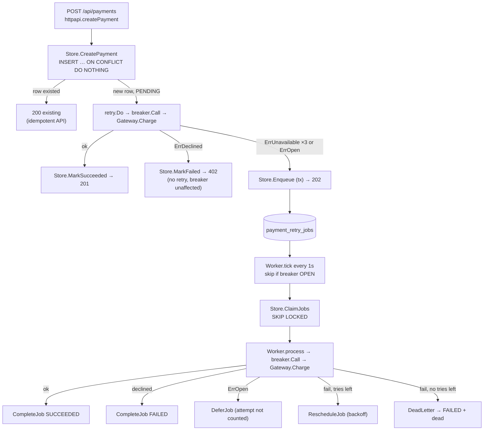
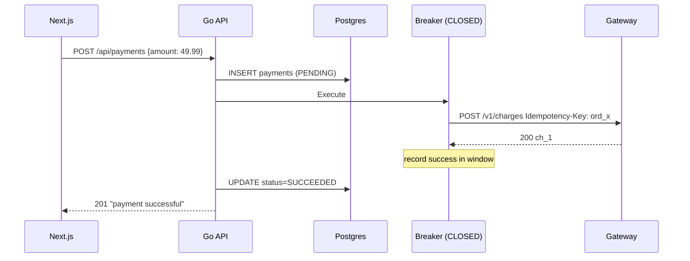
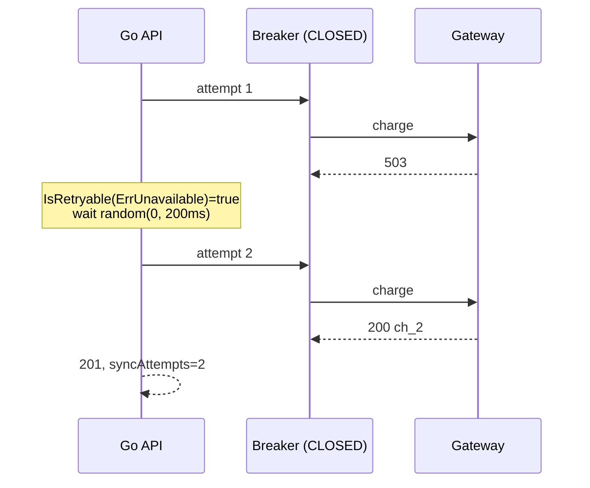
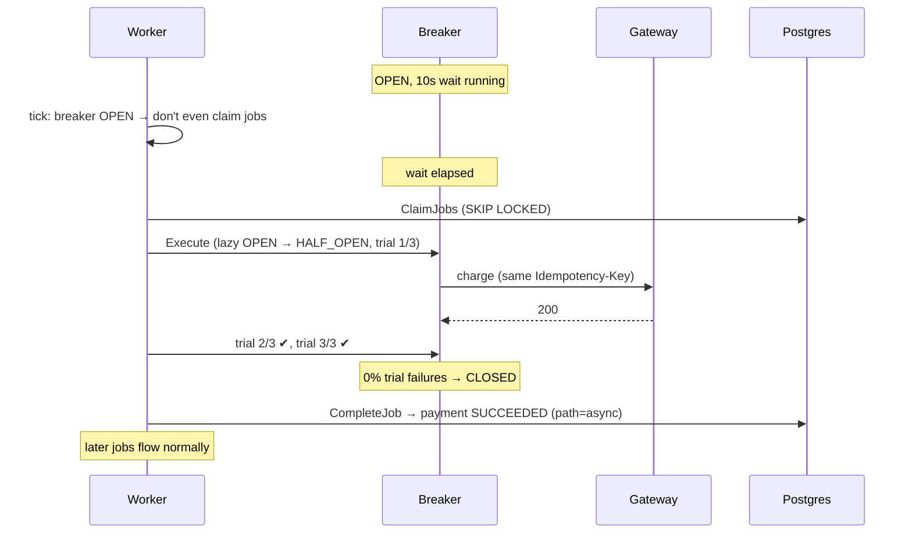
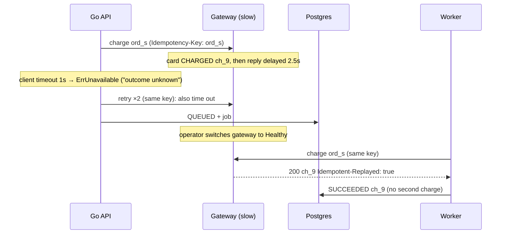
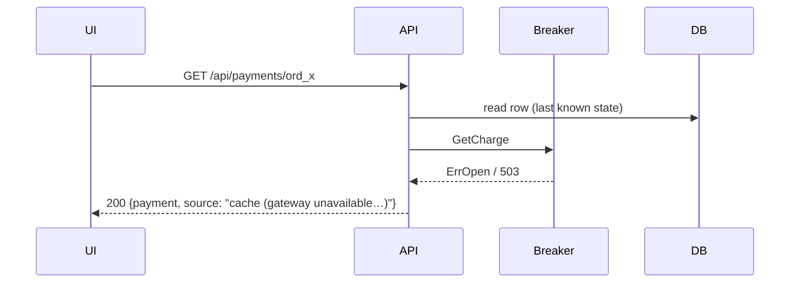

# 02 — Code Walkthrough: every scenario, step by step

Each scenario has a sequence diagram plus pointers to the exact Go functions. Run the demo
alongside it (see the [README](../README.md)) and watch the **Timeline** panel. Its lines
come from the `Events.Add(...)` calls quoted below.

---

## The interview snippet vs. this repo

The scenario gave this Java:

```java
public String processPayment(String orderId) {
    return circuitBreaker.executeSupplier(() -> {
        return callPaymentGateway(orderId);
    });
}
```

The Go equivalent at the heart of [internal/payment/service.go](../internal/payment/service.go):

```go
attempts, err := retry.Do(ctx, policy, func(ctx context.Context, _ int) error {   // Retry (outer)
    c, err := breaker.Call(s.Breaker, func() (gateway.ChargeResult, error) {     // CircuitBreaker (inner)
        return s.Gateway.Charge(ctx, orderID, amountCents)                       // callPaymentGateway
    })                                                                            //   + Idempotency-Key
    charge = c
    return err
})
// err != nil → fallback: s.Store.Enqueue(...)  (QUEUED + retry job, one transaction)
```

The Java snippet alone is **not** a complete answer. It has no retry, no fallback, no
idempotency and no async path. Saying that in the interview is a plus.

In Spring Boot it would look like this:

```java
@CircuitBreaker(name = "paymentGateway", fallbackMethod = "queuePayment")
@Retry(name = "paymentGateway")
public PaymentResult processPayment(String orderId, long amount) {
    return gatewayClient.charge(orderId /* idempotency key */, amount);
}

private PaymentResult queuePayment(String orderId, long amount, Throwable t) {
    outboxRepository.save(new PaymentRetryEvent(orderId, amount));   // same @Transactional
    return PaymentResult.processing(orderId);                         // HTTP 202
}
```

---

## Request lifecycle map



---

## Scenario 1: Happy path



Code: `Service.ProcessPayment` → `breaker.Call` → `Client.Charge` → `Store.MarkSucceeded`.

---

## Scenario 2: Transient blip, saved by retry (Flaky mode)



* Backoff math: `retry.Policy.Backoff` in [internal/retry/retry.go](../internal/retry/retry.go).
* Timeline: `retry · attempt 1 failed (… HTTP 503) — retrying in 87ms`.
* Both attempts are recorded by the breaker (1 failure, 1 success).

---

## Scenario 3: Gateway down, breaker trips, fallback (Down mode + Burst)

```mermaid
sequenceDiagram
    participant API as Go API
    participant CB as Breaker
    participant GW as Gateway
    participant DB as Postgres
    Note over CB: CLOSED
    loop first few calls
        API->>CB: Execute
        CB->>GW: charge
        GW-->>CB: 503
    end
    Note over CB: failures/window ≥ 50% and ≥ 5 calls<br/>→ OPEN (OnStateChange event)
    API->>CB: Execute
    CB-->>API: ErrOpen (≈ 0 ms, no network call)
    Note over API: IsRetryable(ErrOpen)=false → stop retrying
    API->>DB: BEGIN; payments→QUEUED; INSERT retry job; COMMIT
    API-->>API: 202 "order placed, payment processing"
```

Where to look:

* Tripping: `Breaker.record` → `overThreshold` → `transition(Open)` in [internal/breaker/breaker.go](../internal/breaker/breaker.go).
* Rejecting: `Breaker.acquire` returns `ErrOpen` and increments `notPermitted`.
* Fallback: the bottom of `Service.ProcessPayment` → `Store.Enqueue` (one transaction).
* Notice `context.WithoutCancel(ctx)` there. If the user closed the browser tab, we
  **still** must save the queued payment.

In the demo, 20 payments return in about 400 ms in total, instead of 20 × (3 tries × 1s timeout).

---

## Scenario 4: Recovery through HALF_OPEN (Healthy, wait 10s)



* `acquire()` performs the **lazy** OPEN → HALF_OPEN move on the first call after the wait.
  No background timer is needed. (Resilience4j: `automaticTransitionFromOpenToHalfOpenEnabled=false`.)
* `halfStarted` limits concurrent trial calls. The 4th caller during HALF_OPEN still gets `ErrOpen`.
* **Generation counter**: a slow call that started while CLOSED and finishes during
  HALF_OPEN is ignored, so it can't corrupt the trial results.
* If a trial fails, the breaker goes back to OPEN and the wait starts again (seen in the dead-letter scenario).

---

## Scenario 5: Timeout but charged, saved by idempotency (Slow mode)

The most important scenario to understand for payments.



* The fake gateway commits the charge **before** sleeping: `Server.createCharge` → `Server.charge` in [internal/gateway/server.go](../internal/gateway/server.go).
* The duplicates are counted in `stats.duplicatesBlocked`. The UI shows it as **"double charges blocked"**.
* Reconciliation: clicking **check** on the row calls `Service.GetPaymentLive`. If the gateway
  says "succeeded" but we have QUEUED, we fix our record and close the job.

---

## Scenario 6: Never recovers, dead letter (Down, wait ~1 min)

```
async attempt 1/6 failed — next try in 1.9s
breaker CLOSED → OPEN
async attempt 2/6 failed — next try in 1.2s     (jittered: random(0, 4s))
breaker OPEN → HALF_OPEN                         (worker's call is the trial)
async attempt 3/6 failed — next try in 7.0s
async attempt 4/6 failed — next try in 8.6s
breaker HALF_OPEN → OPEN
async attempt 5/6 failed — next try in 25.0s
dlq · gave up after 6 async attempts → dead letter
```

`Store.DeadLetter` marks the payment `FAILED` and the job `dead` in one transaction. In
production you would also:

1. **Alert** (any DLQ growth pages someone).
2. **Notify the customer** with a link to pay another way.
3. **Release the reserved stock** or cancel the order (a saga compensation).
4. Offer an ops tool to **replay** dead jobs after the incident.

Note `Store.DeferJob`: if the breaker rejects a worker call (`ErrOpen`), the job goes back
**without** using up an attempt. We never actually tried, so it shouldn't count.

---

## Scenario 7: Cached read fallback (Down, click "check")



`Service.GetPaymentLive`. **Reads** may degrade to stale data. **Writes** may not.

---

## Scenario 8: Business error (Pay 900)

`Client.Charge` maps HTTP 402 → `ErrDeclined`. Then:

* `IsRetryable(ErrDeclined)` = false → no retry.
* `IsBreakerFailure(ErrDeclined)` = false → recorded as a **success** for health purposes.
* Unit test: `TestBusinessErrorsDoNotTrip` in [internal/breaker/breaker_test.go](../internal/breaker/breaker_test.go).

---

## Concurrency notes (Go-specific)

| Concern | How it's handled |
|---|---|
| Breaker state shared by many goroutines | One `sync.Mutex`. Critical sections are tiny (no I/O inside the lock). |
| Callback calling back into the breaker | `OnStateChange` callbacks are queued and run **after** unlocking (`unlockAndNotify`), so there's no deadlock and they stay in order. |
| Results from an old state | `generation` counter; stale results are dropped. |
| Many workers / many API replicas | Postgres `FOR UPDATE SKIP LOCKED` + lease reclaim. |
| User disconnects mid-payment | The fallback write uses `context.WithoutCancel`. |
| Burst endpoint | Semaphore channel (`sem := make(chan struct{}, 5)`) caps concurrency at 5. |

Note: the breaker is **per process**. With 10 API pods, each pod has its own breaker and
learns on its own. That's normal and fine. A shared (Redis) breaker is rarely worth the extra coupling.

---

## Tests

```powershell
go test ./internal/breaker ./internal/retry -v
```

| Test | Proves |
|---|---|
| `TestStaysClosedBelowMinimumCalls` | minimumNumberOfCalls guard |
| `TestOpensAtThresholdAndRejects` | trips at 50%, rejects without calling fn |
| `TestBusinessErrorsDoNotTrip` | declines are ignored |
| `TestHalfOpenRecoversToClosed` | full OPEN → HALF_OPEN → CLOSED path + event order |
| `TestHalfOpenFailureReopens` | a failed trial reopens the breaker |
| `TestHalfOpenLimitsTrialCalls` | only K concurrent trial calls |
| `TestSlowCallsTrip` | the slow-call rate trips the breaker |
| `TestBackoffGrowsAndCaps` / `TestJitterStaysBelowCap` | backoff math |
| `TestDoStopsOnNonRetryable` / `TestDoRespectsContext` | retry stops correctly |

The breaker tests use a **fake clock** (`cfg.Now`), so the "wait 10s" tests run in microseconds.
That technique is worth mentioning in interviews.
